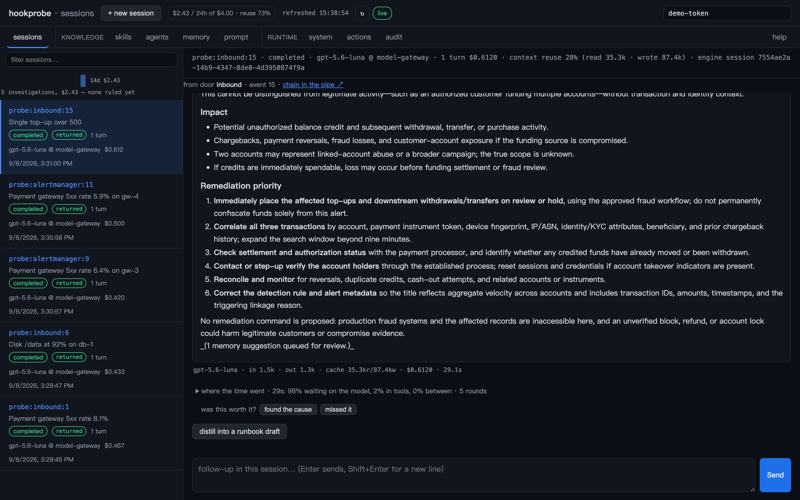

# hookstack

[](https://github.com/itswl/hookstack/actions/workflows/ci.yml)
[](https://github.com/itswl/hookstack/actions/workflows/ci-hookjudge.yml)
[](https://github.com/itswl/hookstack/actions/workflows/ci-hookprobe.yml)

**English** · [中文](README.zh-CN.md)

**Put agents on your production signals without handing them the keys.**

A signal comes in: an alert, a chat message, a ticket, a timer. A pipe signs, routes and prices it. An agent investigates it read-only, and proves it is read-only at startup. The report reaches a person as a card they can rule on. Nothing touches production without a signed press.

| service | what it does |
| --- | --- |
| [`hookrelay`](hookrelay) | **The pipe.** Adapts any webhook, routes it, delivers to chat, and keeps one ledger of every hop. |
| [`hookjudge`](hookjudge) | **The judge.** Decides cheaply whether a person must act now. Most events never pay for a model. |
| [`hookprobe`](hookprobe) | **The investigator.** One read-only agent run per event, behind an OpenClaw-compatible HTTP contract. It also runs on its own. |

The investigator is the product. The pipe and the judge are the smallest alerting front end for a team that has none. One deployment is one team: this is not a work-management platform, a multi-tenant SaaS or an agent framework.

## Start here

- **30 seconds:** [docs/quickstart.md](docs/quickstart.md) opens with the shape of it — three services, one diagram.
- **10 minutes, no keys, no bill:** pipe + judge + a stub model + the investigator on a rehearsal + a readable sink. Docker is the only prerequisite.

  ```bash
  curl -fsSLO https://raw.githubusercontent.com/itswl/hookstack/main/docker-compose.quickstart.yml
  docker compose -f docker-compose.quickstart.yml up -d
  bash <(curl -fsSL https://raw.githubusercontent.com/itswl/hookstack/main/scripts/demo.sh)
  ```

  The demo runs the whole loop: an alert judged, a recorded investigation replayed
  through the real read-only gate, the report as a card, an approve press running
  two allowlisted commands, the alert resolved. [docs/quickstart.md](docs/quickstart.md)
  has the rest of it — a real model, the boards, the half-day path.
- **Half a day, for real:** [STACK.md](STACK.md) runs all three from source; [docs/containment.md](docs/containment.md) is the boundary map you read *before* pointing it at a cluster.
- **What it does, in full:** [docs/what-you-get.md](docs/what-you-get.md).



The three boards read in Chinese or English and follow the system's light or dark; [the full tour](OVERVIEW.md) has every screenshot, from local runs and not mockups.

## How it fits together

```
upstreams ──► hookrelay ──► hookjudge ──► hookrelay ──► chat bridge / webhook
                  │
                  └──► hookprobe ──► hookrelay ──► the same channels
                       (critical/high; a rehearsal until it has a model)
```

The same pipe also carries an operator's own work signals to a planner and, on a person's press, to a work runner ([two deployment shapes, one codebase](docs/deployments.md)).

## Read more

- [docs/quickstart.md](docs/quickstart.md): the one page to start from
- [docs/what-you-get.md](docs/what-you-get.md): the feature list, in full
- [OVERVIEW.md](OVERVIEW.md): the tour, with every screenshot
- [STACK.md](STACK.md): run the whole stack locally, step by step
- [hookrelay](hookrelay/README.md), [hookjudge](hookjudge/README.md), [hookprobe](hookprobe/README.md): each service in depth
- [docs/containment.md](docs/containment.md): the security boundaries
- [docs/bridge-protocol.md](docs/bridge-protocol.md): how a card reaches a chat platform
- [CONTRIBUTING.md](CONTRIBUTING.md): gates and workflow

## Developing

`bash scripts/gate.sh` runs every service's gate plus the stack checks. Read its verdict before you commit. The pipe caps itself at 6,450 source lines and the judge at 3,400; the investigator is uncapped.

MIT licensed.
