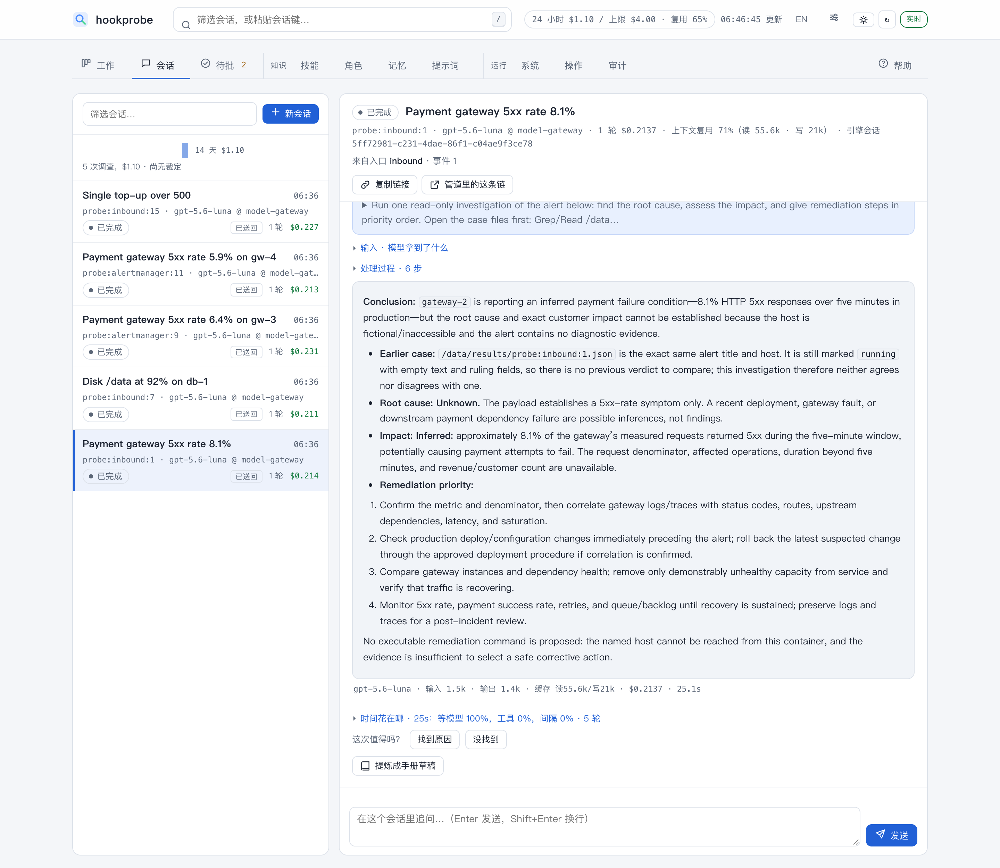

[English](../) · **中文**

**让 agent 值班，但不把钥匙交出去。**

一条信号进来：告警、聊天消息、工单、定时任务。管道给它签名、路由、计价。agent 只读地调查它，并在启动时证明自己是只读的。报告作为一张卡片到人手里，人可以直接裁定。没有一次签名的按下，什么都碰不到生产。

| 服务 | 做什么 |
| --- | --- |
| `hookrelay` | **管道。** 接任意 webhook，路由，投递到聊天，每一跳都记进同一本账。 |
| `hookjudge` | **判官。** 便宜地判断是否需要有人马上处理。大多数事件用不着调模型。 |
| `hookprobe` | **调查员。** 每个事件跑一次只读的 agent 调查，对外是 OpenClaw 兼容的 HTTP 契约。也能单独使用。 |

调查员是产品本身，管道和判官是给没有告警平台的团队准备的最小前端。一套部署就是一个团队：它不是工作管理平台，不是多租户 SaaS，也不是 agent 框架。

## 从这里开始

- **30 秒：**[docs/quickstart.md](../quickstart.md) 开头就讲清了它的形状 —— 三个服务，一张图。
- **10 分钟，不要 key，不花钱：** 同一页的第二段会在排练上跑完整条闭环：告警被判定，调查经过真实的只读门回放，卡片，按下批准，告警恢复。
- **半天，真上：**[STACK.md](https://github.com/itswl/hookstack/blob/main/STACK.md) 从源码一步步跑起三个服务；[docs/containment.md](../containment.md) 是指向真实集群**之前**要读的边界地图。
- **完整功能清单：**[docs/what-you-get.md](../what-you-get.md)（英文）。



三块看板都能切换中英文，并跟随系统的浅色或深色；[完整介绍](https://github.com/itswl/hookstack/blob/main/OVERVIEW.md)（英文）里有全部截图，取自本地真实运行，不是效果图。

## 怎么串起来

```
上游 ──► hookrelay ──► hookjudge ──► hookrelay ──► 聊天桥 / webhook
             │
             └──► hookprobe ──► hookrelay ──► 同样的通道
                  （critical/high；没有模型时跑排练）
```

同一条管道也搬运操作者自己的工作信号，交给规划器，再经人按下交接后由执行节点去做（[两种部署形状，一份代码](../deployments.md)）。

## 继续读

*   [完整的叙述性总览（OVERVIEW.md）](https://github.com/itswl/hookstack/blob/main/OVERVIEW.md)（英文）
*   [hookprobe 参考文档](https://github.com/itswl/hookstack/blob/main/hookprobe/README.md)（英文）
*   [把三件套一起跑起来（STACK.md）](https://github.com/itswl/hookstack/blob/main/STACK.md)（英文）
*   [安全边界（containment）](../containment.md)（英文）

MIT 协议。
